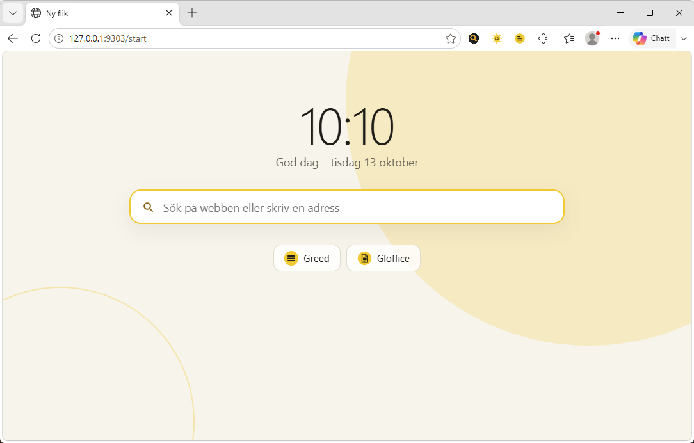
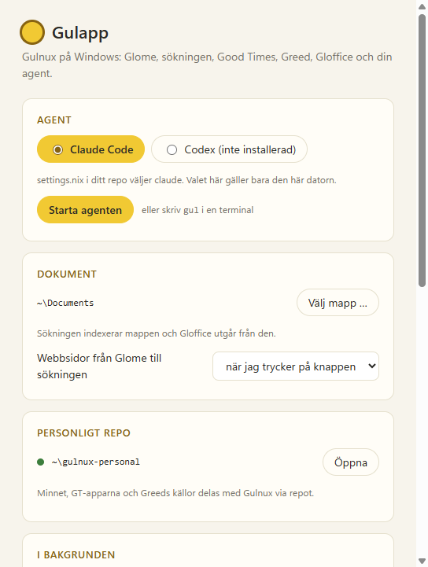
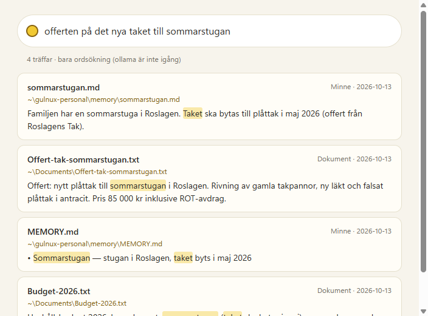

# Gulapp – Gulnux för Windows

Gulapp ger en Windows-dator samma program och samma minne som Gulnux: webbläsaren Glome,
sökningen, Good Times, Greed, Gloffice och Gul-agenten (Claude Code eller Codex). Det
personliga repot (`gulnux-personal`) delas, så minnet, GT-apparna och Greeds källor följer
med mellan Gulnux och Windows.

<p align="center">
  
</p>

Gulapp är en sol i aktivitetsfältet. Den visar vad agenten gör (grå: inte igång, gul: väntar,
en prick som snurrar: arbetar, röd prick: behöver dig) och samlar resten i sin meny:

- **Agenten** startar i Windows Terminal (fönstret `gul`) med Gulnux kontext, ditt minne,
  dina GT-appar och MCP-servrar för Glome, sökningen, Greed, Gloffice och GT. Den kan också
  startas med `gul` i vilken terminal som helst.
- **Glome** är Microsoft Edge med en egen profil, fjärrstyrning för agenten (port 9222),
  Gulnux tillägg fästa i verktygsfältet och startsidan med dagens val från Greed.
- **Sök** söker i dokumentmappen du valt, minnet och sidor sparade från Glome.
- **Greed** och **Gloffice** öppnas i Glome.
- **Good Times** schemalägger handlingar i Windows Schemaläggaren (mappen `\Gulnux\`) och
  meddelar resultatet som Windows-notiser.

<p align="center">
  
  
</p>

## Installera

Allt installeras på användarnivå och kräver inga administratörsrättigheter.

1. Installera [Node.js](https://nodejs.org) och [Git](https://git-scm.com) om de saknas.
2. Klona Gulnux och starta Gulapp:

   ```
   git clone https://github.com/gustafmaknor/gulnux.git %USERPROFILE%\gulnux
   cd %USERPROFILE%\gulnux\windows\gulapp
   npm install
   npm start
   ```

   I PowerShell på datorer där skript är avstängda (`npm.ps1 cannot be loaded`): skriv
   `npm.cmd` i stället för `npm`.

3. Inställningsfönstret visar vad som saknas, med en knapp för varje: uv och Python-miljön
   (för sökningen, Greed och Gloffice), Claude Code eller Codex, och frivilligt Ollama för
   sökning på betydelse. Klona ditt personliga repo därifrån om du har ett.

Gulapp lägger sig i Start-menyn och startar när du loggar in (går att stänga av). Kommandona
`gul`, `gt`, `greed`, `gulsearch`, `gloffice`, `glome` och `glome-read` finns i nya terminaler.

Uppdatera med `gul update` (hämtar den senaste grunden) och starta om Gulapp.

## Var saker ligger

| | |
|---|---|
| `%APPDATA%\Gulapp\settings.json` | Gulapps inställningar: agent, dokumentmapp, tjänster |
| `%LOCALAPPDATA%\Gulapp\bin` | kommandona (`.cmd`), i din PATH |
| `%LOCALAPPDATA%\Gulapp\python` | Python-miljön för sökningen, Greed och Gloffice |
| `%LOCALAPPDATA%\Gulapp\Glome` | Glomes Edge-profil |
| `%LOCALAPPDATA%\Gulapp\logs` | loggar från sökningen och Greed |
| `~\gulnux-personal` | ditt personliga repo, samma som på Gulnux |
| `~\.config`, `~\.local` | samma kataloger som på Gulnux, så att apparna fungerar likadant |

## Så skiljer det sig från Gulnux

- **Agentens inställningar rör inte din övriga Claude Code.** `gul` startar Claude Code med
  Gulnux kontext, MCP-servrar och statushooks som flaggor (`--append-system-prompt-file`,
  `--mcp-config`, `--settings`), så `~\.claude` gäller som vanligt när du kör `claude` i
  andra projekt. Codex läser bara sin egen katalog, så där skrivs `~\.codex\AGENTS.md` och
  `config.toml` som på Gulnux, utan att skriva över något du skrivit själv.
- **Glome loggas inte in med datorns Microsoft-konto.** Edge loggar annars in nya profiler
  med jobbkontot och synkar historik och lösenord. Glome stänger av det (`msImplicitSignin`).
- **GT-knappen fungerar även när native messaging är avstängt.** Jobbdatorer kan stänga av
  värdprogram på användarnivå med policyn `NativeMessagingUserLevelHosts`. Då går knappen via
  Gulapps brygga på `127.0.0.1:9304`, som bara tar emot anrop från GT-tillägget.
- **Ingen rollback.** Agenten frågar innan den ändrar något i Windows (se
  `agent/AGENTS-windows.md`).
- **Lärandet** (observation och veckovis reflektion) finns inte i Gulapp än.

## Utveckla

```
cd windows\gulapp
npm test                     # kommandon, kontext, MCP, hooks, gul, bryggan, ikoner
                             # (med uv i PATH även Python-miljön och apparna)
npm start                    # starta Gulapp
```

`GULAPP_DRY=1` gör att registret, PATH, Start-menyn och autostarten inte rörs, och med
`GULAPP_LOCAL`, `GULAPP_SETTINGS`, `USERPROFILE` och `XDG_*` hamnar allt i en testkatalog.
`GULAPP_SHOT=<katalog>` tar skärmdumpar av fönstren och avslutar.

```
main.mjs            ikonen, bakgrundstjänsterna, fönstren och bryggan
lib/config.mjs      sökvägar, inställningar, agentval
lib/commands.mjs    kommandotabellen: .cmd-filerna och agenternas MCP-servrar
lib/agent.mjs       kontexten och agenternas konfiguration (det gul.sh gör på Gulnux)
lib/setup.mjs       PATH, native messaging, Python-miljön, det personliga repot
lib/glome.mjs       Glome (Edge)
lib/gtbridge.mjs    GT-knappens brygga
lib/icons.mjs       ikonerna, ritade i kod
cli/                gul, glome, glome-mcp och gul-agent-status
ui/                 inställningar och sök
```
